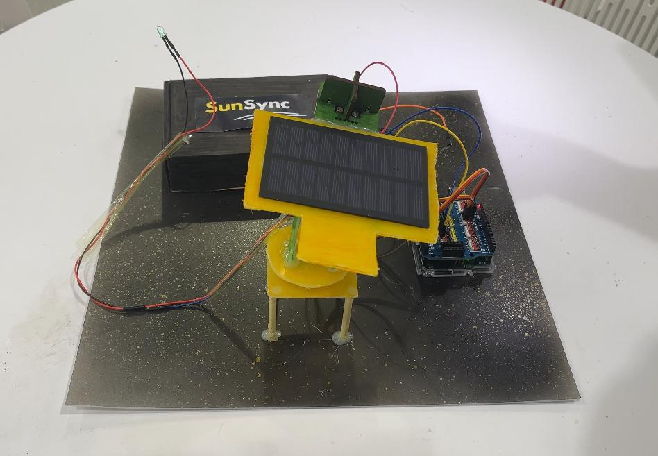

# SunSync: Dual Axis Sun Tracking Solar Panel

An Arduino based solar panel that turns toward a light source on two axes. Built as a team of four for ENGR1000J Introduction to Engineering (Project 2) at the UM-SJTU Joint Institute, Shanghai Jiao Tong University, in 2024.

## How it works
Four light dependent resistors (LDRs) sit around the solar panel. The Arduino reads them, compares the light on opposite sides, and moves two servo motors one degree at a time toward the brighter side until the readings balance. One servo turns the panel horizontally and the other tilts it vertically.

1. Read the four LDRs.
2. Compute the vertical and horizontal differences.
3. If a difference is above the threshold (50 ADC counts), move that servo by 1 degree toward the brighter side.
4. Wait 80 ms and repeat.

## Hardware
- Frame cut from polypropylene sheets, joined with hot glue and nuts and bolts
- 2 servo motors (horizontal and vertical)
- Arduino microcontroller
- Solar panel with 4 LDRs
- LED that shows the power output, and a power switch

Pin mapping used in the code:

| Part | Pin |
| --- | --- |
| Horizontal servo | D10 |
| Vertical servo | D9 |
| LDR top right | A2 |
| LDR top left | A3 |
| LDR bottom right | A1 |
| LDR bottom left | A0 |

## Run it
1. Open `code/sun_tracker/sun_tracker.ino` in the Arduino IDE.
2. Wire the parts as in the pin table (the `Servo` library is built in).
3. Upload to the board. Open the Serial Monitor at 9600 baud to see the sensor values and servo positions.

## What was tested
- Tracking: in 2 flashlight trials the panel followed the moving light and the output stayed stable.
- Range: both servos are commanded over 0 to 180 degrees.

## Limitations
The prototype was not compared against a fixed panel in a measured test, so there is no measured efficiency gain. The report includes a theoretical estimate from a simple idealised model (about 1.57 times the daily energy of a flat fixed panel). That is a calculation, not a measurement.

## Report
A rewritten LaTeX version of the lab report is in [`docs/report/`](docs/report/main.pdf) (source: `main.tex`).

## My role
[Fill in what you personally did on this project.]
